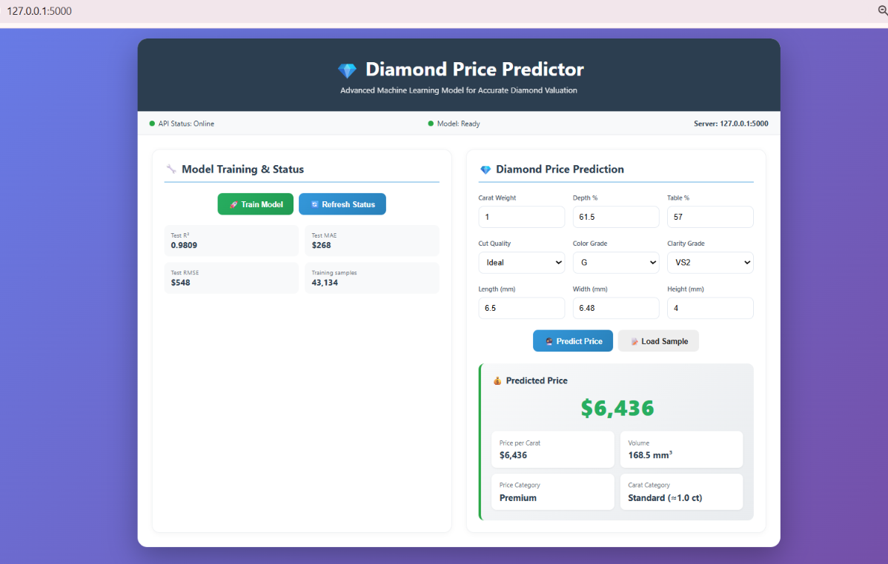

# 💎 Diamond Price Predictor

A machine-learning web app that predicts a diamond's price from its physical and quality attributes
(carat, cut, color, clarity, depth, table and x/y/z dimensions).
Built during my Machine Learning internship at Manipal Institute of Technology (Jun–Aug 2025).


**Stack:** Python · scikit-learn (Random Forest Regressor) · pandas · Flask · HTML/CSS/JavaScript

## Results (hold-out test set, 80/20 split)

| Metric | Value |
| --- | --- |
| Test R² | ~0.98 |
| Test MAE | ~$270 |
| Test RMSE | ~$550 |

Most important features: carat, y (width), clarity, color.

## Dataset

[Kaggle – Diamonds](https://www.kaggle.com/datasets/shivam2503/diamonds) (53,940 rows). A copy is included as `diamonds.csv`.
Cleaning removes rows with zero dimensions and extreme outliers (carat > 5, depth/table outside 40–80, price > $20,000).

## Project structure

```
├── app.py              # Flask API + serves the web UI
├── model.py            # DiamondPricePredictor class (training, prediction, save/load)
├── templates/
│   └── index.html      # Frontend
├── diamonds.csv        # Dataset
├── requirements.txt
└── README.md
```

## Run it locally

```bash
git clone <your-repo-url>
cd diamond-price-predictor
python -m venv venv
venv\Scripts\activate          # Windows   (macOS/Linux: source venv/bin/activate)
pip install -r requirements.txt

python model.py                # trains the model and creates diamond_model.pkl
python app.py                  # open http://localhost:5000
```

You can also skip `python model.py` and click **Train Model** inside the web page.

> `diamond_model.pkl` is ~250 MB, which is above GitHub's 100 MB file limit, so it is not committed. It is regenerated by the step above.

## API

| Method | Endpoint | Description |
| --- | --- | --- |
| GET | `/api/health` | Health check |
| GET | `/api/status` | Whether the model is loaded, metrics, dropdown options |
| POST | `/api/train` | Train and save the model |
| POST | `/api/predict` | Predict price from JSON |

Example:

```bash
curl -X POST http://localhost:5000/api/predict -H "Content-Type: application/json" \
  -d '{"carat":1.0,"cut":"Ideal","color":"G","clarity":"VS2","depth":61.5,"table":57,"x":6.5,"y":6.48,"z":4.0}'
```

## Future scope

- Hyperparameter tuning with cross-validation
- Compare with Gradient Boosting / XGBoost
- Deploy to a cloud platform
